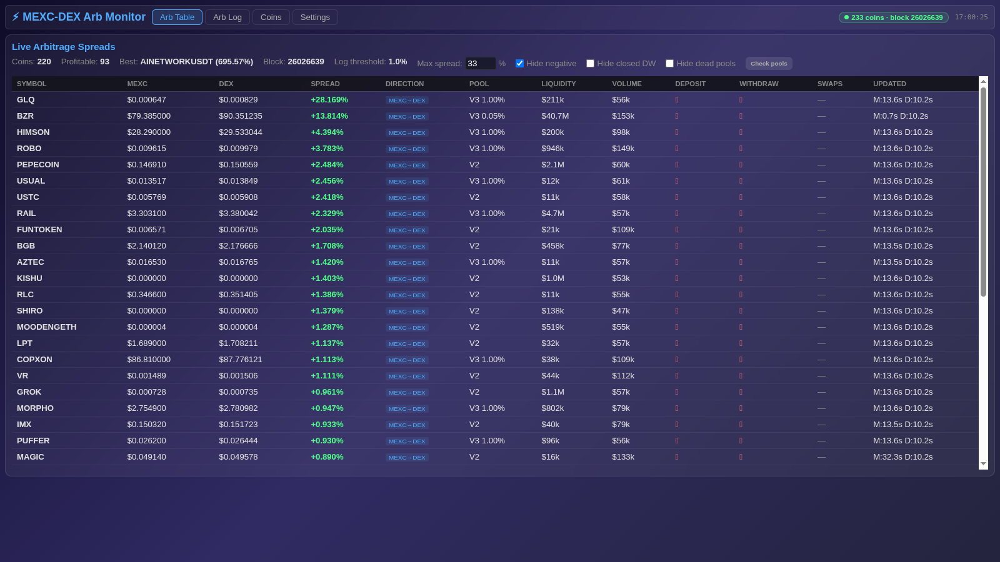

# CEX/DEX Arbitrage Dashboard

Comparing an exchange price with a decentralised market is only the beginning of evaluating an opportunity. This dashboard brings market screening, trade-size comparisons and execution controls into one workspace, helping the operator inspect the opportunity in context before acting.

## Tech stack

| Layer | Technologies |
|---|---|
| Application | Python, FastAPI |
| Supporting technologies | HTML, CSS, JavaScript; Web3.py; MEXC, Gate, Uniswap; TradingView |

## Build a useful watchlist

Discover supported pools and organise monitored assets into active tabs. Saved selections reduce repetitive setup when returning to the same market. Connection indicators show which parts of the trading workspace are currently available.

A working watchlist turns a broad market search into a repeatable research session. Return to the assets already under review, then add a new pool when there is a reason to investigate it.

## Compare both directions

Separate arbitrage tables make the buy and sell directions easier to compare across different trade sizes. Net-value and return figures help distinguish an apparent price gap from an opportunity worth investigating. They support a decision rather than guaranteeing an executable profit.

Trade size changes the question. Comparing several sizes in both directions helps the operator see where an attractive headline spread stops being attractive once the proposed amount is considered.

## Screen and refine opportunities

The scanner ranks supported pairs and offers controls for narrowing the list. Ignore choices and onboarding tools help keep attention on relevant markets instead of repeatedly checking unsuitable assets. Pool context adds information when evaluating a newly discovered pair.

Use the scanner to assemble candidates and the watchlist to keep the useful ones close. This separates discovering a market from deciding whether it belongs in an active trading session.

## Inspect market context

Exchange order books, recent trades and chart views sit beside the comparison. They help the operator examine depth and recent movement before choosing an action. Keeping these views together reduces the effort of cross-checking a possible trade.

An opportunity is easier to review when the quote, market depth and recent trades are visible together. The operator can examine the comparison without repeatedly rebuilding the context in another application.

## Keep execution deliberate

Manual swap and configured automation controls provide different ways to act on a reviewed opportunity. Profit thresholds, order choices, cooldowns and gas-related preferences support the operator's execution plan. Settings and test panels help inspect the configured environment before using it.

Manual work and configured automation stay connected to the same market context. The operator can inspect the thresholds and execution preferences before choosing the mode suited to the task.

## Adapt the workspace

Layout, sounds and privacy preferences make the trading desk easier to use across different sessions. Logs and health information assist with interruptions.

The same desk can support a focused research session or a longer period of observation. Presentation preferences help keep the important information readable while diagnostics remain available for interruptions.

---

Private code: [cex-dex-arb](https://github.com/logicencoder/cex-dex-arb)

See [REPOS.md](REPOS.md) for related repositories.

**[Logic Encoder](https://logicencoder.com)** · [GitHub](https://github.com/logicencoder) · [Contact](https://logicencoder.com/contact/)
