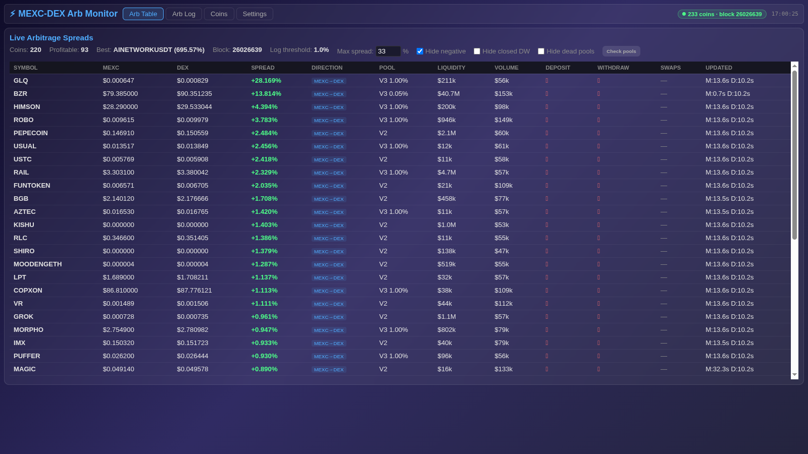

# CEX/DEX Arbitrage Dashboard

Comparing an exchange price with a decentralised market is only the beginning of evaluating an opportunity. This dashboard brings market screening, trade-size comparisons and execution controls into one workspace, helping the operator inspect the opportunity in context before acting.

## Tech stack

| Layer | Technologies |
|---|---|
| Application | Python, FastAPI |
| Supporting technologies | HTML, CSS, JavaScript; Web3.py; MEXC, Gate, Uniswap; TradingView |

## Build a useful watchlist

**Load pools** reads the stored pools, **Active Coins** keeps the markets under review as tabs, and **Live stats** and **Pool Info** show the selected pair and its pool. Connection indicators show which parts of the workspace are currently available: the wallet, and the MEXC and Gate API and trading connections.

A working watchlist turns a broad market search into a repeatable research session. Return to the assets already under review, then add a new pool when there is a reason to investigate it.

## Compare both directions

The **Arbitrage** tables show buying on the exchange and selling on the DEX, and the reverse, for several trade sizes. Net value and return figures help tell an apparent price gap from an opportunity worth investigating. They support a decision and do not promise an executable profit.

Trade size changes the question. Comparing several sizes in both directions helps the operator see where an attractive headline spread stops being attractive once the proposed amount is considered.

## Screen and refine opportunities

The **ARB SCANNER** has tabs for **Discover** (new candidate pairs, each of which can be sent to the queue or ignored), the **Pool tester queue**, the **Ignore list** and the stored coins with their pool details (pair, DEX type, fee, token), which come from the pool lab or are saved by hand. A scanner log records what the scan did.

Use the scanner to assemble candidates and the watchlist to keep the useful ones close. This separates discovering a market from deciding whether it belongs in an active trading session.

## Inspect market context

**Live Orderbooks** for MEXC and Gate.io, the account's own trades and all trades on each exchange, and a TradingView chart sit beside the comparison, so depth and recent movement can be checked before an action.

An opportunity is easier to review when the quote, market depth and recent trades are visible together. The operator can examine the comparison without repeatedly rebuilding the context in another application.

## Keep execution deliberate

A **Manual Swap** panel buys or sells through the MEV-protected route, and the **Swap gate** readout shows whether swapping is currently allowed. **Automatic Trading** starts disabled and shows a connectivity checklist (wallet address, key and validation; API, trading and connection state for MEXC and Gate) before it can be applied; cooldowns and gas preferences are set there, and a test panel checks the configured environment.

Manual work and configured automation stay connected to the same market context. The operator can inspect the thresholds and execution preferences before choosing the mode suited to the task.

## Adapt the workspace

Settings cover font sizes, scanner row height and table layout, panel sizes, sounds and privacy options, and startup behaviour: automatically resuming the monitor on start is off by default and recommended off. A live activity log records what the desk did.

The same desk can support a focused research session or a longer period of observation. Presentation preferences help keep the important information readable while diagnostics remain available for interruptions.

---

Private code: [cex-dex-arb](https://github.com/logicencoder/cex-dex-arb)

See [REPOS.md](REPOS.md) for related repositories.

**[Logic Encoder](https://logicencoder.com)** · [GitHub](https://github.com/logicencoder) · [Contact](https://logicencoder.com/contact/)
